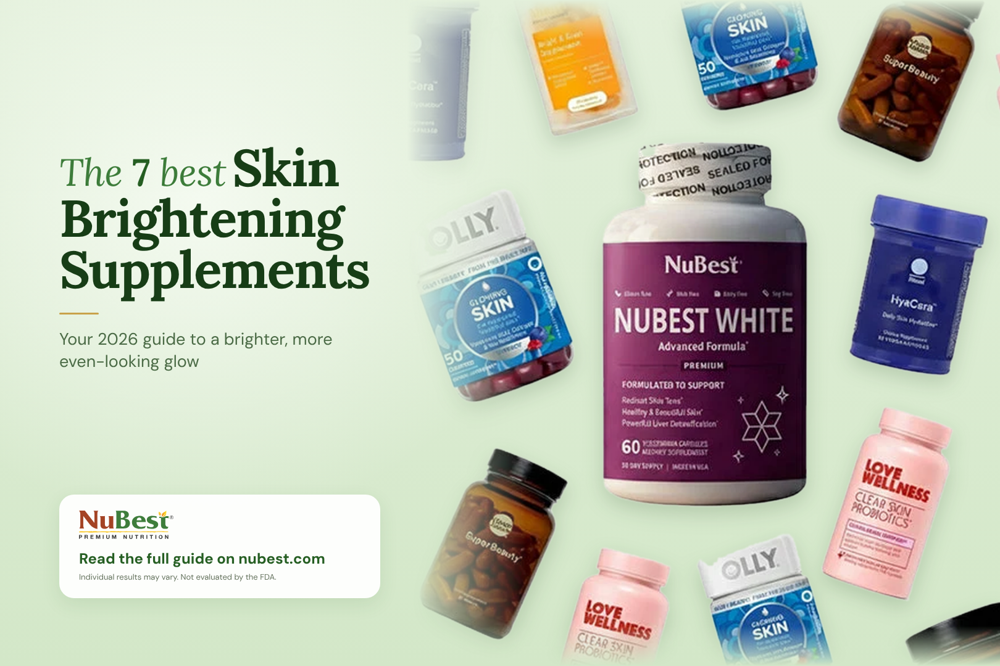

# Skin Brightening Ingredient Guide



A small, static web page that helps people make sense of skin brightening supplements. Pick your main skin concern and the page shows the ingredients most often associated with it. A simple daily checklist covers the basics that matter more than any supplement.

Built with plain HTML, CSS, and a few lines of vanilla JavaScript. No frameworks, no build step, no tracking.

## Features

- **Ingredient matcher:** select a concern (dullness, dark spots, uneven tone, or dryness) to see related ingredients and a short note.
- **Daily skin basics checklist:** SPF, hydration, sleep, produce, and an evening routine, with a "done today" counter.
- **Local-only storage:** checklist progress is saved in your browser with `localStorage` and never leaves your device.
- **Light and dark mode:** follows your system setting.
- **Accessible markup:** labeled form controls and an `aria-live` region for matcher results.

## Project structure

```
.
├── index.html     # Page markup and inline JavaScript
├── style.css      # Styles, including dark mode
├── README.md
└── assets/
    └── top-7-skin-brightening-supplements-3x2.png
```

## Run it locally

Clone the repository and open `index.html` in any modern browser. No server is required.

```bash
git clone https://github.com/<your-username>/skin-brightening-ingredient-guide.git
cd skin-brightening-ingredient-guide
open index.html   # macOS. On Windows use: start index.html
```

## Deploy with GitHub Pages

1. Go to **Settings → Pages** in this repository.
2. Under **Build and deployment**, set **Source** to *Deploy from a branch*.
3. Choose the `main` branch and the `/ (root)` folder, then click **Save**.

The site will be available at `https://<your-username>.github.io/skin-brightening-ingredient-guide/`.

## Customizing the data

The ingredient mapping and the checklist items live in two objects near the bottom of `index.html`:

```js
const CONCERNS = { /* concern → ingredients + note */ };
const HABITS = [ /* daily checklist items */ ];
```

Edit them to add concerns or change the checklist. The page re-renders from these objects, so no markup changes are needed.

## Data source

The concern-to-ingredient mapping is based on the ingredient breakdown in NuBest's [comparison of seven skin brightening supplements](https://www.nubest.com/blogs/beauty-care/best-skin-brightening-supplements). The article is published on the brand's own blog and ranks the brand's product first.

## Disclaimer

This project is for general information only and is not medical advice. Talk with a doctor or pharmacist before starting any supplement, especially if you are pregnant, nursing, taking medication, or managing a health condition.
